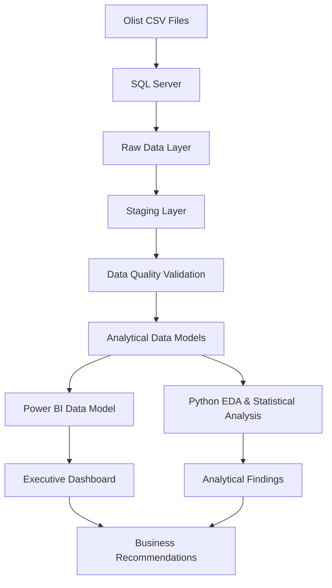

# E-commerce Order Fulfilment & Customer Experience Analytics

**End-to-End Data Analytics Project | SQL Server | Python | Power BI**

An analytical investigation of marketplace order fulfilment efficiency, delivery reliability, geographical performance and customer satisfaction using the Brazilian Olist E-Commerce dataset.

**Project Status:** In Progress

---

## 1. Executive Summary

### Project Overview

This project investigates the operational performance of an e-commerce marketplace by analysing historical order transactions, fulfilment activities, seller information, geographical characteristics and customer reviews.

The primary objective is to understand how efficiently customer orders are fulfilled, identify operational bottlenecks and investigate the relationship between delivery performance and customer satisfaction.

The project follows an end-to-end analytical workflow covering business requirements, data modelling, data quality, exploratory data analysis, KPI development, dashboarding and executive reporting.

### Expected Business Value

- Evaluate order fulfilment efficiency.
- Identify delivery performance problems.
- Investigate differences across sellers and geographical regions.
- Understand the relationship between delivery delays and customer satisfaction.
- Recommend evidence-based operational improvements.

---

## 2. Business Problem & BRD Summary

### Business Context

E-commerce marketplaces coordinate transactions involving multiple sellers, customers, products and logistics activities.

Operational inefficiencies can lead to delayed deliveries, unsuccessful orders and poor customer experiences.

Management requires an integrated analytical view of these activities to understand performance and prioritise improvement opportunities.

### Core Business Question

**How efficiently does an e-commerce marketplace fulfil customer orders, where are its major operational bottlenecks, and how do delivery problems relate to customer satisfaction?**

### Key Business Objectives

1. Measure overall order and delivery performance.
2. Identify late-delivery patterns and operational bottlenecks.
3. Evaluate seller-level and geographical performance.
4. Investigate product category and freight patterns.
5. Evaluate delivery performance in relation to customer reviews.
6. Develop actionable recommendations for management.

### Assumed Business Stakeholders

The following stakeholders represent the intended business audience for this independent analytical case study.

| Stakeholder | Analytical interest |
|---|---|
| Head of Operations | Order fulfilment efficiency |
| Supply Chain Manager | Delivery reliability |
| Commercial Manager | Freight and sales indicators |
| Customer Experience Manager | Customer satisfaction |
| Senior Management | Business performance and recommendations |

**Detailed documentation:** [Business Requirements Document](docs/01_business_requirements_document.md)

---

## 3. Project Scope

### In Scope

- Historical order performance.
- Delivery lead times and late deliveries.
- Seller performance.
- Geographical performance.
- Product category analysis.
- Freight charge analysis.
- Customer review analysis.
- Operational and customer experience segmentation.

### Out of Scope

- Actual warehouse inventory optimisation.
- Courier-specific performance attribution.
- Actual logistics profitability.
- Predictive demand forecasting.
- Causal claims unsupported by the available data.

---

## 4. Dataset Overview

**Dataset:** Brazilian E-Commerce Public Dataset by Olist

**Source:** [Kaggle – Olist Brazilian E-Commerce Dataset](https://www.kaggle.com/datasets/olistbr/brazilian-ecommerce)

**Historical period:** Approximately September 2016 – October 2018. Exact date coverage will be validated during data profiling.

**Dataset composition:** Nine related CSV files.

| Dataset | Business information |
|---|---|
| Orders | Order lifecycle and delivery timestamps |
| Order Items | Purchased products, sellers and prices |
| Customers | Customer identification and location |
| Sellers | Seller identification and location |
| Payments | Payment types and transaction values |
| Reviews | Customer ratings and comments |
| Products | Product categories and physical dimensions |
| Geolocation | Geographic coordinates |
| Category Translation | English product category names |

Raw dataset files are obtained separately from Kaggle and are not distributed through this repository.

---

## 5. Technology Stack

| Technology | Purpose |
|---|---|
| Microsoft SQL Server | Relational storage, data modelling and transformations |
| Python | Data exploration, statistical analysis and visualisation |
| Pandas | Data manipulation and analysis |
| Matplotlib | Analytical visualisations |
| SciPy | Statistical hypothesis testing |
| SQLAlchemy / pyodbc | Python-to-SQL Server connectivity |
| Power BI | KPI reporting and interactive dashboards |
| Git / GitHub | Version control and project documentation |

---

## 6. Data Architecture

The project follows a structured, batch-oriented analytical architecture.



### Architecture Principles

- Preserve the original source data.
- Separate raw data from transformed data.
- Validate data before analytical consumption.
- Maintain consistent business KPI definitions.
- Minimise duplicated transformation logic.
- Make analysis reproducible.

**Detailed documentation:** [Architecture and Data Model](docs/07_architecture_and_data_model.md)

---

## 7. Analytical Approach

The investigation follows a broad-to-narrow analytical progression.

### 7.1 Overall Business Performance

Establish baseline performance across order volume, delivery outcomes, cancellations and customer satisfaction.

### 7.2 Delivery Performance

Investigate delivery times, estimated versus actual delivery dates and operational bottlenecks.

### 7.3 Geographic and Operational Segmentation

Compare performance across regions, sellers and product categories.

### 7.4 Customer Experience

Examine customer reviews and investigate their relationship with delivery performance.

### 7.5 Statistical Investigation

Test selected hypotheses and distinguish observed associations from causal explanations.

---

## 8. KPI Framework

| KPI | Business definition |
|---|---|
| Total Orders | Number of distinct orders |
| Successful Delivery Rate | Share of eligible orders successfully delivered |
| Cancellation Rate | Share of orders cancelled |
| On-Time Delivery Rate | Share of delivered orders meeting their estimates |
| Average Delivery Time | Average purchase-to-delivery duration |
| Average Delivery Delay | Average difference between actual and estimated delivery |
| Average Review Score | Average customer rating |
| Negative Review Rate | Proportion of low-rated reviews |
| Freight-to-Product Value Ratio | Freight charges relative to item value |

Formal KPI definitions, eligibility conditions, denominators and calculation rules will be documented in the KPI dictionary.

**Detailed documentation:** [KPI Dictionary](docs/04_kpi_dictionary.md)

---

## 9. Key Business Insights

*To be populated after completing data profiling, exploratory analysis and validation.*

### Insight 1 — [Finding]

- Observed result:
- Supporting evidence:
- Business implication:

### Insight 2 — [Finding]

- Observed result:
- Supporting evidence:
- Business implication:

### Insight 3 — [Finding]

- Observed result:
- Supporting evidence:
- Business implication:

Only validated analytical findings will be reported here. No conclusions will be invented before analysis.

---

## 10. Power BI Executive Dashboard

*Dashboard previews will be added after completion of the reporting phase.*

### Planned Dashboard Sections

1. Executive Overview
2. Delivery Performance
3. Seller and Geographic Analysis
4. Product and Freight Analysis
5. Customer Experience

**Planned Power BI file:** `powerbi/Olist_Fulfilment_Analytics.pbix`

---

## 11. Business Recommendations

*To be completed after validating the analytical findings.*

For every recommendation, document:

- Identified business problem.
- Supporting analytical evidence.
- Recommended management action.
- Expected operational benefit.
- Relevant limitations and implementation considerations.

---

## 12. Repository Structure

```text
olist-ecommerce-fulfilment-analytics/
│
├── docs/          Business and technical documentation
├── sql/           SQL database and analytical scripts
├── notebooks/     Python EDA and statistical analysis
├── powerbi/       Power BI dashboard
├── reports/       Executive reports
├── assets/        Diagrams, charts and dashboard previews
├── data/          Local dataset instructions
│
├── .gitignore
├── README.md
└── requirements.txt   (to be added)
```

---

## 13. Reproduction Guide

### Prerequisites

- Microsoft SQL Server.
- SQL Server Management Studio (SSMS).
- Python and required libraries.
- Visual Studio Code / Jupyter.
- Power BI Desktop.
- Git.

### Step 1 — Clone the Repository

```bash
git clone https://github.com/abhi-udnoor/olist-ecommerce-fulfilment-analytics.git
```

### Step 2 — Obtain the Dataset

Download the original Olist dataset from Kaggle.

Follow the instructions in `data/README.md` to store the CSV files locally.

### Step 3 — Prepare the Python Environment

```bash
python -m venv .venv
```

Activate the environment and install dependencies:

```bash
pip install -r requirements.txt
```

### Step 4 — Prepare SQL Server

Follow the ordered scripts under `sql/` to create the database, load the source files, perform transformations and validate analytical data.

### Step 5 — Execute Python Analysis

Open the notebooks in the documented execution order.

Run the exploratory analysis and statistical investigations.

### Step 6 — Open the Power BI Dashboard

Open the `.pbix` file and configure the SQL Server connection according to the documented instructions.

### Step 7 — Review Final Reports

Review the executive report and analytical recommendations under `reports/`.

*Exact environment configuration, script execution order and connection instructions will be finalised during the implementation phases.*

---

## 14. Assumptions and Limitations

- The data represents historical marketplace activity, not current operating performance.
- Delivery comparisons use the timestamps supplied in the dataset.
- The dataset does not provide complete carrier-level logistics information.
- Freight charges must not be interpreted as actual logistics costs.
- Customer review associations do not independently establish causation.
- Any exclusions, data-quality issues and analytical assumptions will be documented.

**Detailed documentation:** [Assumptions and Limitations](docs/08_assumptions_and_limitations.md)

---

## 15. Project Documentation

| Document | Location |
|---|---|
| Business Requirements Document | `docs/01_business_requirements_document.md` |
| Project Charter | `docs/02_project_charter_and_scope.md` |
| Stakeholder Requirements | `docs/03_stakeholder_requirements.md` |
| KPI Dictionary | `docs/04_kpi_dictionary.md` |
| Data Dictionary | `docs/05_data_dictionary.md` |
| Data Quality Report | `docs/06_data_quality_report.md` |
| Architecture | `docs/07_architecture_and_data_model.md` |
| Assumptions and Limitations | `docs/08_assumptions_and_limitations.md` |
| Decision Log | `docs/09_decision_log.md` |

---

## 16. Author & Contact

**Author:** Abhi Udnoor

**Location:** Prague, Czechia

**LinkedIn:** [Add your LinkedIn URL](YOUR_LINKEDIN_URL)

**GitHub:** [abhi-udnoor](https://github.com/abhi-udnoor)

---

*This project is an independent educational and portfolio case study using the publicly available Olist historical dataset. All findings and recommendations will be based on the available data and documented analytical assumptions.*
