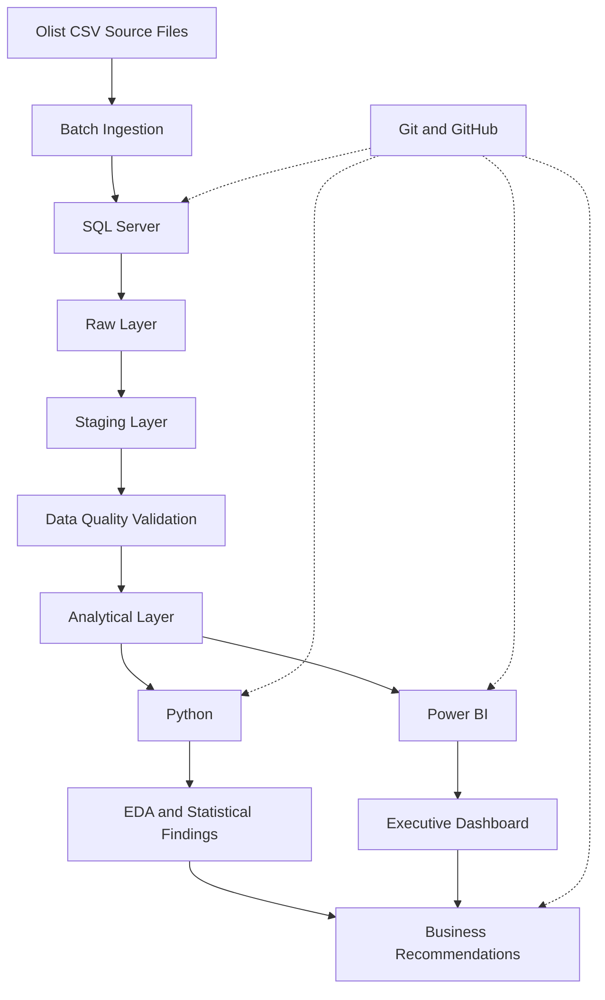

# Lean Tool Stack & Logical Architecture
# Logistics SLA Performance & Customer Retention Risk Analysis

## 1. Architecture Objective

The project requires a practical, maintainable analytical architecture for approximately 100,000 historical orders distributed across nine related source datasets.

The architecture should support:

- Reliable relational data management.
- Reproducible transformations.
- Statistical and exploratory analysis.
- Interactive business reporting.
- Version control and project documentation.

The solution will use a local, batch-oriented architecture rather than unnecessary distributed or cloud infrastructure.

**Architecture principle:** Select each technology according to its responsibility, not merely because it is popular or resume-friendly.

---

## 2. Selected Technology Stack

### 2.1 Microsoft SQL Server

**Role:** Central relational database and transformation layer.

Responsibilities:

- Store original source records.
- Manage raw, staging and analytical schemas.
- Validate keys and relationships.
- Perform relational joins and aggregations.
- Standardise data types.
- Create reusable analytical tables and views.
- Implement agreed business KPI definitions and customer cohorts.

**Reason for selection:**

The source consists of related relational datasets with different table grains.

SQL Server provides structured storage, relational operations and reusable business logic close to the data.

It will serve as the central analytical foundation.

**Supporting interface:** SQL Server Management Studio (SSMS).

### 2.2 Python

**Role:** Exploratory, statistical and diagnostic analysis.

| Component | Responsibility |
|---|---|
| Python | Analytical programming environment |
| Pandas | Data exploration, profiling and segmentation |
| Matplotlib | Statistical and exploratory visualisation |
| SciPy | Statistical hypothesis testing |
| pyodbc | Connectivity to SQL Server |

**Supporting interface:** Visual Studio Code with Jupyter Notebook support.

**Reason for selection:**

SQL Server will prepare reliable analytical datasets.

Python will provide a flexible environment for exploring distributions, investigating relationships, comparing customer cohorts and conducting statistical tests.

The separation prevents exploratory analysis from becoming unnecessarily mixed with core database transformations.

### 2.3 Microsoft Power BI Desktop

**Role:** Business intelligence and executive reporting.

Responsibilities:

- Connect to curated SQL Server analytical outputs.
- Develop the reporting data model.
- Create presentation-level DAX measures.
- Build interactive dashboards.
- Enable management segmentation and performance investigation.

**Reason for selection:**

Business stakeholders require an accessible reporting interface rather than direct access to SQL queries or analytical notebooks.

Core business definitions will be established in SQL. DAX will support filter-responsive reporting calculations based on those definitions.

### 2.4 Git and GitHub

**Role:** Version control and portfolio publishing.

Responsibilities:

- Track SQL scripts and Python notebooks.
- Maintain documentation history.
- Record implementation decisions.
- Publish project deliverables.
- Support reproducibility and professional review.

**Reason for selection:**

A reliable analytical project should maintain a traceable history of changes and a clear structure that another analyst can understand.

---

## 3. Tools Deliberately Excluded

| Technology | Decision | Reason |
|---|---|---|
| Microsoft Excel | Excluded from core pipeline | SQL Server and Power BI cover the required preparation and reporting responsibilities. |
| Tableau | Excluded | Duplicates Power BI reporting functionality. |
| Databricks / Spark | Excluded | Distributed processing is unnecessary for this dataset. |
| Snowflake / BigQuery | Excluded | A separate cloud data warehouse is not justified. |
| dbt | Excluded | An additional transformation framework is unnecessary for this standalone SQL Server workflow. |
| Airflow | Excluded | No recurring scheduled pipeline requiring orchestration. |
| Docker | Excluded | Containerisation adds little value to the local implementation. |
| Machine Learning Frameworks | Excluded | Predictive churn modelling is outside the agreed scope. |

These tools are not inherently unsuitable for enterprise analytics. They are excluded because their additional capabilities are not required by this project.

---

## 4. Logical Data Architecture

The architecture uses one central database and two primary analytical consumers.

GitHub stores the project code and documentation, not the live database or source datasets.

---

## 5. Responsibilities by Processing Layer

### Raw Layer

Purpose:

Preserve the source data as received.

Principles:

- Retain original source records.
- Avoid business transformations.
- Record ingestion and source information.
- Preserve a reproducible relationship to the original Kaggle files.

### Staging Layer

Purpose:

Prepare data for reliable analysis.

Activities:

- Validate and standardise data types.
- Inspect missing values.
- Investigate duplicates.
- Validate identifiers and relationships.
- Identify invalid values.
- Apply documented cleaning rules.

### Analytical Layer

Purpose:

Provide reusable business-ready data.

Activities:

- Establish correct analytical grain.
- Build reusable relational models.
- Prepare order, seller and customer-level analytical outputs.
- Implement agreed business definitions.
- Produce curated views for Python and Power BI.

---

## 6. Division of Analytical Responsibilities

| Task | Primary Technology | Reason |
|---|---|---|
| Relational storage | SQL Server | Structured data management |
| Table joins | SQL Server | Relational processing |
| Key and relationship validation | SQL Server | Data integrity |
| Core transformations | SQL Server | Reusable database logic |
| Canonical business KPIs | SQL Server | Consistent business definitions |
| Customer cohort preparation | SQL Server | Relational and temporal processing |
| EDA | Python | Flexible exploration |
| Distribution analysis | Python | Analytical libraries |
| Hypothesis testing | Python | SciPy statistical functionality |
| Exploratory visualisation | Python | Matplotlib |
| Interactive reporting | Power BI | Business intelligence |
| Version control | Git / GitHub | Reproducibility |

Some operations can technically be performed in multiple tools. The division above represents the chosen architecture, not a limitation of either SQL or Python.

---

## 7. Data Flow and Connectivity

1. Original Kaggle CSV files are downloaded locally.
2. Data is ingested into SQL Server using a documented batch process.
3. The raw layer preserves source information.
4. Staging processes validate and standardise the data.
5. Analytical models and views provide validated business-ready datasets.
6. Python connects to SQL Server for EDA and statistical investigation.
7. Power BI connects to SQL Server analytical outputs for executive reporting.
8. Results and recommendations are documented in GitHub.

No independent duplicated transformation pipeline will be maintained in Python and Power BI.

---

## 8. Development Environment

| Component | Selected Environment |
|---|---|
| Database | Local Microsoft SQL Server instance |
| Database Interface | SQL Server Management Studio |
| Programming | Python |
| Development Environment | Visual Studio Code |
| Notebook Environment | Jupyter support in VS Code |
| Reporting | Power BI Desktop |
| Version Control | Git and GitHub |
| Source Data | Kaggle |

Specific software editions, Python versions and database connection configurations will be confirmed during implementation.

---

## 9. Data Governance and Repository Rules

- Original source files must remain unchanged.
- Raw and processed CSV files are excluded from GitHub by default.
- Database credentials must never be committed.
- The .gitignore file must exclude sensitive and temporary files.
- SQL scripts must have a clear execution order.
- Python environments and dependencies must be documented.
- KPI definitions must have one authoritative specification.
- Analytical findings must include supporting evidence and limitations.

---

## 10. Architecture Decision Summary

The project adopts a lean, local analytical architecture based on four core technologies:

1. SQL Server — relational storage and transformations.
2. Python — exploratory and statistical investigation.
3. Power BI — management reporting.
4. Git/GitHub — version control and publishing.

This architecture provides the necessary capabilities without introducing tools whose operational complexity exceeds their practical value for the project.

**Architecture classification:** Local, batch-oriented, relational analytics pipeline.

**Deployment status:** Independent portfolio implementation, not a live production service.

---

*End of Tool Stack and Architecture Document.*
